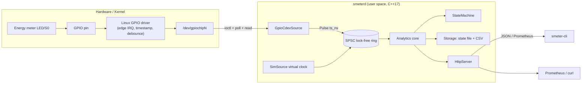
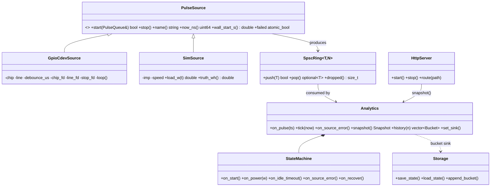
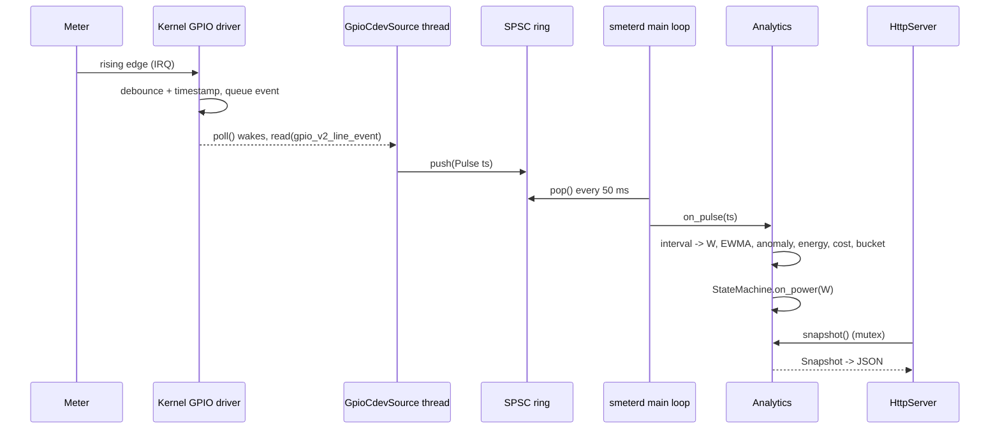
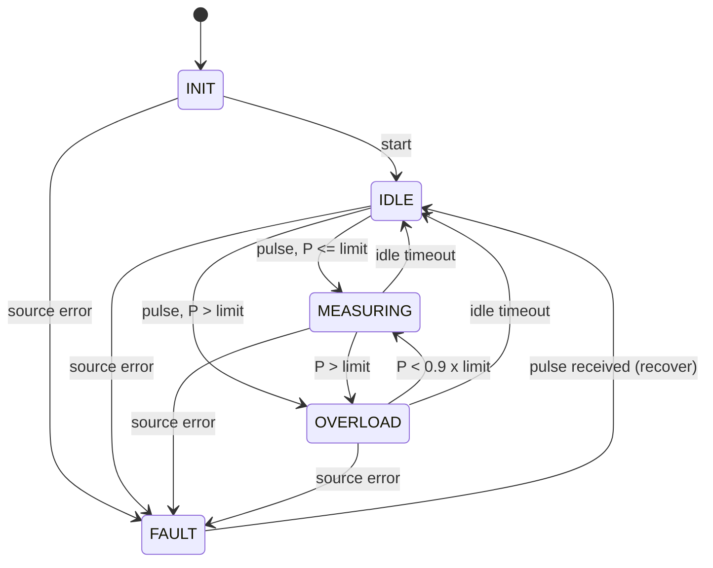
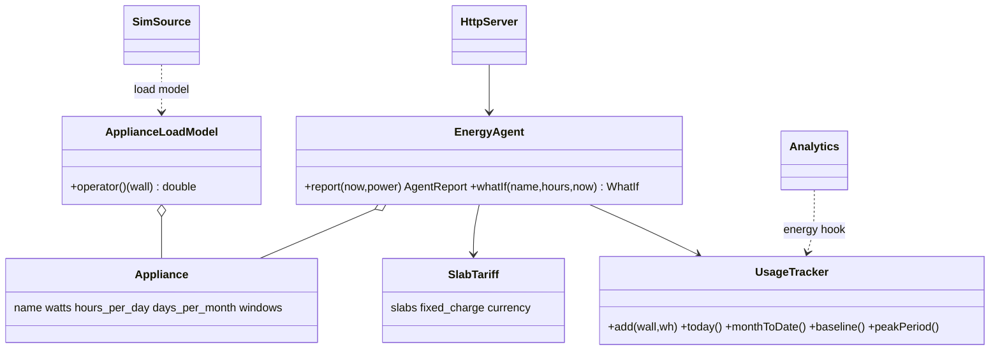

# System Design & Architecture

## 1. Layered architecture

## 2. Linux device-driver concepts used
| Concept | Where |
|---|---|
| Character device node `/dev/gpiochipN` | `GpioCdevSource::start` (`open`) |
| `ioctl` (`GPIO_V2_GET_LINE_IOCTL`) with `gpio_v2_line_request` | line request, edge + bias + debounce attributes |
| Kernel interrupt handling → event FIFO | kernel timestamps each edge (`gpio_v2_line_event.timestamp_ns`) |
| `poll()` / `eventfd` / blocking `read()` | event loop with clean shutdown |
| Kernel-side debounce (`GPIO_V2_LINE_ATTR_ID_DEBOUNCE`) | first debounce stage (hardware); analytics is second stage |
| `gpio-sim` + configfs/sysfs | hardware-in-the-loop testing (`scripts/gpio_sim_setup.sh`, `pulse-injector`) |
| `errno` handling, fd lifetime (RAII), `CLOCK_MONOTONIC` | all drivers |

> **Why not an in-kernel module?** The kernel module interface is C. The brief mandates C++ only, so the driver layer
> is the *user-space* GPIO uAPI — the same ABI that production user-space drivers use — with a pluggable HAL so a
> custom `/dev/smeterN` device can be added as another `PulseSource`.

## 3. Components
| Component | Responsibility |
|---|---|
| `PulseSource` (HAL) | start/stop, produce `Pulse{ts_ns}`, report clock, flag failure |
| `GpioCdevSource` | real GPIO driver client |
| `SimSource` | synthetic load, virtual clock, ground-truth energy |
| `SpscRing<T,N>` | wait-free hand-off between source thread and analytics |
| `Analytics` | debounce, power, energy, EWMA, anomaly, TOU cost, minute buckets, thread-safe snapshot |
| `StateMachine` | INIT/IDLE/MEASURING/OVERLOAD/FAULT |
| `Storage` | atomic state file (tmp + fsync + rename), CSV log |
| `HttpServer` | REST + Prometheus |
| `smeter-cli` | terminal dashboard |

## 4. Data structures
`Pulse{uint64 ts_ns}` · `Config` (meter constant, thresholds, tariff) · `Bucket{minute,wh,peak_w,cost,pulses}` ·
`Snapshot` (read-only view for API) · `PersistedState{pulses,energy_wh,cost}` · sliding window `deque<double>` (50 samples) ·
history `deque<Bucket>` (1440 = 24 h).

**Formulas:** `E_pulse = 1000/imp_per_kWh` Wh · `P = 3.6e6 / (imp_per_kWh · Δt)` W.

## 5. Class diagram

## 6. Sequence diagram — one pulse

## 7. State machine diagram

## 8. Threading model
Source thread (producer) → lock-free ring → main thread (consumer, 50 ms cadence) → `Analytics` (mutex) ← HTTP thread (reader). The source thread never blocks; overflow increments a drop counter.

## 9. Implementation plan, environment, Git strategy
* Tools: g++ ≥ 9 (C++17), GNU make, Linux kernel headers (`linux/gpio.h`), optional `gpio-sim`, curl, ASan/UBSan/TSan.
* Setup: `sudo apt install build-essential linux-libc-dev curl` → `make`.
* Branching: `main` (stable, tagged) ← `develop` ← `feature/<name>`; PRs must pass CI (`.github/workflows/ci.yml`). Conventional commits.
* Tracking: `docs/PROGRESS.md` (log of issues and solutions), GitHub Issues/Projects per PRD requirement ID.

## 10. Smart Energy Agent extension (v2.0)
See [SMART_AGENT.md](SMART_AGENT.md). New modules (all header-only, no change to the existing pipeline except one optional hook):
`calendar`, `tariff`, `slab_monitor`, `appliance`, `usage_tracker`, `smart_bill`, `recommendations`, `energy_agent`, `agent_json`.

