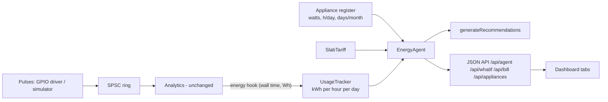

# Smart Energy Agent - feature guide (extension, v2.0)

The agent sits **on top of** the existing pulse pipeline; nothing in the original flow was rewritten.
One hook (`Analytics::set_energy_sink`) passes every accepted pulse's energy to a `UsageTracker`.

## Where each required function lives
| Function | File | What it does |
|---|---|---|
| `calculateBill()` | `tariff.hpp` | Telescopic slab billing + fixed charge, with a per-slab breakdown |
| `getCurrentSlab()` / `getUnitsToNextSlab()` | `tariff.hpp` | Slab index and units left before the next slab |
| `calculateEnergyConsumption()` | `appliance.hpp` | `kWh = W x hours / 1000` (monthly = daily x days) |
| `rankAppliancesByConsumption()` | `appliance.hpp` | Sorts appliances; cost = slab energy charge split by share |
| `calculatePotentialSavings()` | `appliance.hpp` | "What if I save?" - re-prices the month with the real tariff |
| `calculateProjectedConsumption()` | `slab_monitor.hpp` | month-to-date + remaining days x (60 % last-7-day avg + 40 % month avg) |
| `calculateDailySavingTarget()` | `slab_monitor.hpp` | (projected - threshold) / remaining days |
| `evaluateSlab()` | `slab_monitor.hpp` | Green / Yellow / Red zone + message |
| `detectConsumptionSpike()` | `usage_tracker.hpp` | Finds hours far above the typical hourly profile |
| `generateRecommendations()` | `recommendations.hpp` | Data-driven advice (see below) |
| `smartBillCalculator()` | `smart_bill.hpp` | Manual bill calculator |
| `EnergyAgent::report()` | `energy_agent.hpp` | Collects everything for the dashboard |

Data structures: `struct`s (`Slab`, `Bill`, `Appliance`, `Spike`, `Recommendation`, `AgentReport`), `std::vector` (slabs, appliances, rankings),
`std::map<long, std::array<double,24>>` (hourly kWh per day), `std::optional<Spike>`, `std::function` (energy hook, load model),
file handling in `Storage` (`usage_hourly.csv`, atomic write).

## Demo tariff (editable in `SlabTariff`)
1-100 units @ 2.50 - 101-200 @ 3.50 - 201-300 @ 5.00 - 300+ @ 7.00, fixed charge 30. Currency symbol: rupee.
Telescopic: only the units inside a slab are charged at that slab's rate.

## Slab warning logic (`evaluateSlab`)
* **Red - High consumption:** projected units have crossed into a higher slab within reach (<= 25 % of the projected units above the boundary), or you are in the top slab.
* **Yellow - Approaching:** current units within `max(5, 8 % of the boundary)` of the next slab, or the projection is that close.
* **Green - Safe:** otherwise.
The 25 % reach rule stops early-month false alarms (e.g. 16 units used, projected 190: no unrealistic "cut 90 units").

## Recommendations (all computed from data)
1. **Slab crossing** - exact units to cut and money saved: `bill(projected) - bill(threshold)`.
2. **Action** - which appliance can deliver it: `hours = excess / (kW x remaining days)`, never an essential appliance (fridge).
3. **Spike** - the unusual window and the appliance whose wattage matches the extra load.
4. **Top appliance** - prices a 30-minute/day cut with the slab tariff.
5. **Peak shifting** - shiftable appliances running 6-10 PM, priced with the time-of-use rates.
6. **Trend** - today vs usual for this time of day.
Sorted by estimated rupee impact; the dashboard shows the top 3.

## The 12 questions - where to find the answer
| # | Question | Where |
|---|---|---|
| 1 | How much electricity am I using? | Live Meter tab (power now), Smart Agent: units this month / today |
| 2 | Approximate bill? | Smart Agent: current bill + projected monthly bill |
| 3 | Current slab? | Smart Agent: "Current slab" card + slab bar |
| 4 | How close to next slab? | "Units to next slab" + zone badge |
| 5 | What causes most consumption? | "Top consuming appliance" + breakdown chart |
| 6 | End-of-month consumption? | "Projected month units" |
| 7 | What actions can I take? | Top 3 recommendations |
| 8 | Units I could save? | "Potential units saved" |
| 9 | Money I could save? | "Potential money saved" |
| 10 | Daily reduction target? | "Daily saving target" (or daily allowance) |
| 11 | What if I reduce an appliance? | "What if I save?" tab |
| 12 | Increasing or decreasing? | "Consumption trend" card |

## REST endpoints added
`GET /api/agent` (everything) - `GET /api/appliances` - `GET /api/tariff` -
`GET /api/whatif?appliance=Air%20conditioner&hours=1.5` -
`GET /api/bill?units=92&days=27&month_days=30&prev=100&avg=3.2` (prev, avg optional).

## Simulation
`smeterd --sim` now uses the **appliance profile** (default): the pulse generator follows the appliance register's schedules
(about 190 units/month), the month starts pre-filled with 14 days of history, and today includes an unusual evening AC spike (7-10 PM) so the spike
detector can be demonstrated. Use `--profile classic` for the original load profile and `--no-spike-demo` to drop the spike.
Tip: `./build/smeterd --sim --start-hour 21.3 --speed 60` jumps straight to the evening so the spike warning shows immediately.

## Viva talking points
* Pulses -> kWh (counter) -> hourly buckets (tracker) -> projection -> slab bill -> advice: one data flow, each step a small testable function.
* Savings are never invented: what-if uses `W x h x days / 1000` and re-prices the whole month with the slab tariff.
* Spike = an hour that is > 1.5x and > mean + 2 sigma above the same hour on previous days.
* Appliance costs add up to the real energy charge (proportional allocation).
